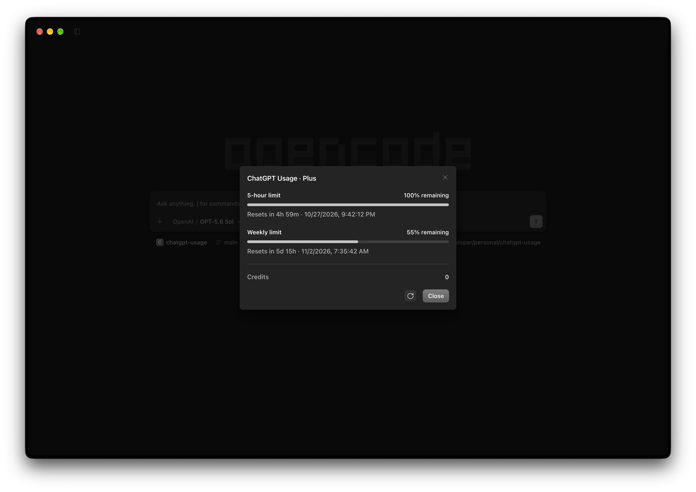

# ChatGPT Usage

Shows ChatGPT plan limits and reset times in OpenCode Desktop and the TUI with `/limits`.

<p align="center">
  
</p>

## Install

```sh
opencode plugin add github:LeoSM-07/chatgpt-usage
```

## Login

This requires a legacy Codex login. Run `/connect`, choose **OpenAI**, then use
**Codex browser (legacy)** or **Codex device code (legacy)**. The newer
**Sign in with ChatGPT** login cannot access the usage endpoint.
